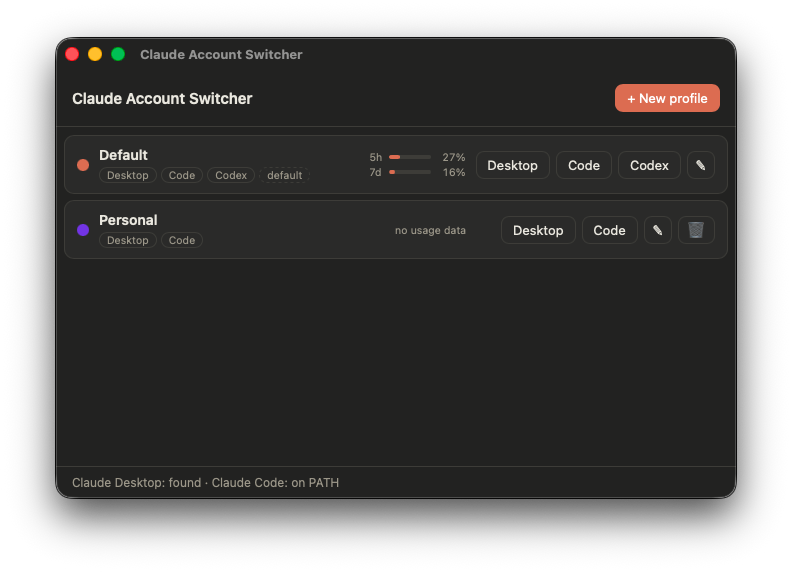

# Claude Account Switcher

A small desktop app for people with more than one Claude account. It manages named
profiles ("Personal", "Work", …) and launches **Claude Desktop**, **Claude Code**, or
**OpenAI Codex CLI** under the selected profile — each with its own login, settings,
sessions, MCP servers, skills, and plugins.

> **Status:** early development (pre-release). macOS first; Windows next; Linux planned (beta).



## Install

Grab the build for your platform from [Releases](../../releases). The builds are
**unsigned** (no paid developer certificates yet), so the OS will object once:

- **macOS**: after moving the app to Applications, either right-click → **Open**,
  or go to System Settings → Privacy & Security → **"Open Anyway"** after the
  first blocked launch. Alternatively: `xattr -cr "/Applications/Claude Account Switcher.app"`.
- **Windows**: SmartScreen will warn — click **More info** → **Run anyway**.
- **Linux**: beta; AppImage and .deb provided.

## How it works

- **Claude Desktop** is an Electron app, so each profile gets its own
  `--user-data-dir`, which keeps login sessions fully separate.
  ⚠️ This is standard Electron behavior but **not officially supported by Anthropic**
  and could break with any Claude Desktop update.
- **Claude Code** supports the official `CLAUDE_CONFIG_DIR` environment variable.
  Each profile gets its own config dir; credentials are isolated per directory
  (on macOS, Claude Code namespaces its Keychain entry per config dir automatically).
  The app installs per-profile shell shims (e.g. `claude-work`) and can open a
  terminal pre-configured for a profile.
- **OpenAI Codex CLI** supports the `CODEX_HOME` environment variable the same
  way (`auth.json` and config live inside it), so profiles get `codex-<name>`
  shims too. The ChatGPT desktop app is native (not Electron), so there is no
  desktop-app equivalent for Codex.

## Known quirks

- **Email login codes land in the wrong window.** When you log a new profile in
  by email, the "Sign in" button in the verification email opens a `claude://`
  link — and the OS routes that to your *main* Claude instance, so the code
  shows up there. This can't be intercepted; just copy the code from wherever
  it appears into the login screen of the *new* window. The app shows a
  reminder on a profile's first login.
- **Usage stats ask for Keychain access (macOS).** The per-profile usage bars
  read each profile's Claude Code login token (read-only) to query Anthropic's
  usage API. On macOS that token lives in the Keychain, so the first read
  triggers an "allow access?" prompt — click **Always Allow** to stop it
  reappearing. The app never modifies or refreshes tokens.
- **Claude Code launches start in your home directory.** The recommended flow
  is the profile's **Terminal** dialog: copy the shown command and paste it in
  your own terminal, in the project directory you actually want to work in.

## Development

```sh
npm install
npm run tauri dev
```

Built with [Tauri v2](https://v2.tauri.app) (Rust + TypeScript).

## Disclaimer

This is an independent open-source project. It is **not affiliated with,
endorsed by, or supported by Anthropic or OpenAI**. "Claude" is a trademark of
Anthropic, PBC; "OpenAI" and "Codex" are trademarks of OpenAI. The app relies
partly on undocumented behavior (see Known quirks) that could change at any
time. It reads login tokens only to display usage and never sends them
anywhere except to the respective vendor's own API.

## License

[MIT](LICENSE)
